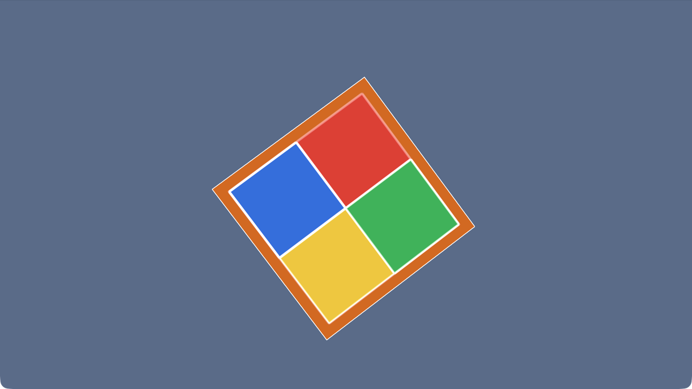
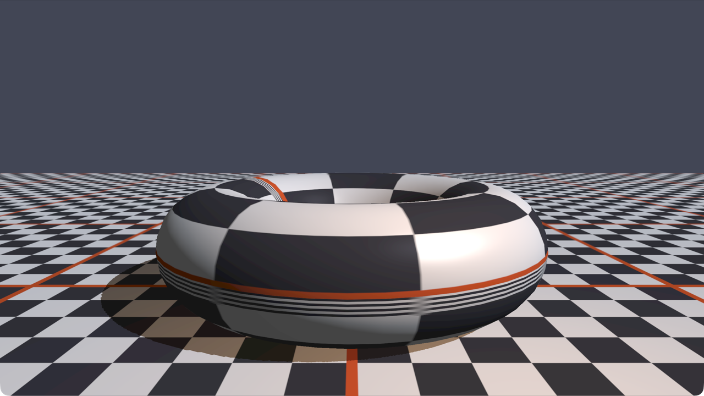
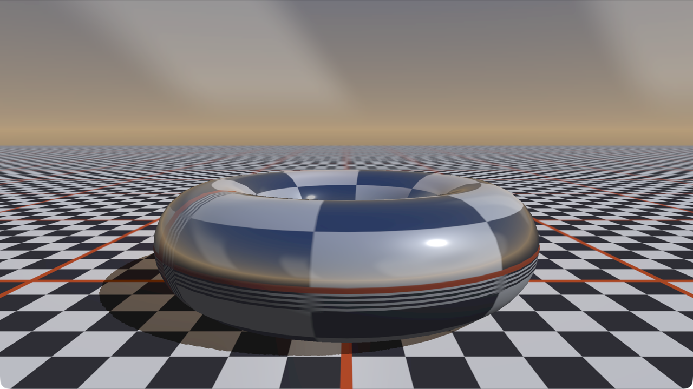
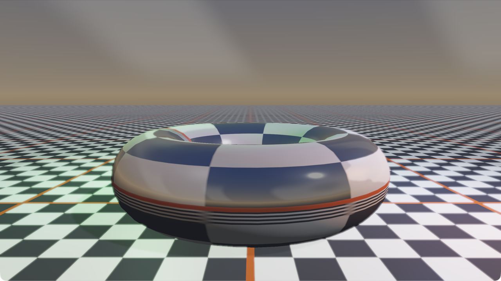
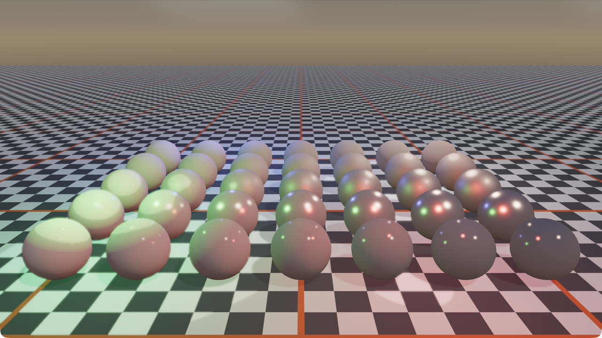
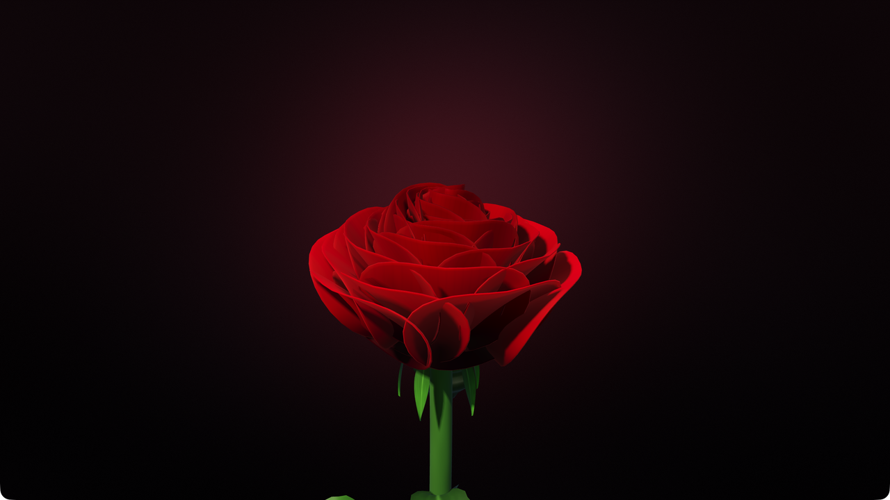

# Class-OpenGL: A Modern OpenGL C++ Wrapper Engine

<div align="left"><b>English</b> · <a href="README.zh-CN.md">简体中文</a></div>

[](LICENSE)

A rendering engine skeleton built around C++17 and OpenGL 3.3 Core Profile.
Every GL resource (program / buffer / VAO / texture / framebuffer) is managed by an RAII class, with copying disabled and moving enabled;
every GL call is wrapped in `GLCall`, which in Debug builds prints `file:line call error code` and breaks immediately on failure.

## Screenshots

> Captured on macOS / Apple M4 with 4x MSAA.

**03_cube — textured cube, depth testing and a free camera**


**05_lighting — OBJ model, materials, directional + point lights with Blinn-Phong shading**


**06_text — real-time text overlay: FPS, resolution, MSAA and current render backend**


**08_postprocess — offscreen scene + composable post-processing chain (Edge effect shown)**



**09_shadow — directional light shadow map + PCF soft shadows**



**10_skybox — cubemap skybox with environment reflections**



**11_hdr — RGBA16F HDR scene, Reinhard tone mapping and bloom**



**12_pbr — Cook-Torrance PBR: 7×5 metallic / roughness sphere grid + multiple lights**



**13_rose — procedural rose: 48 golden-angle spiral petals (thin-shell geometry), sepals/stem/leaves/thorns, directional shadows and ACES tone mapping**



## Feature Overview

| Module | Files | Description |
|---|---|---|
| Window | `engine/Window/Window.*` | GLFW window/context, callbacks, VSync, MSAA |
| Error checking | `engine/Core/GLCall.h` | Wraps every GL call in Debug builds |
| Shaders | `engine/Renderer/Shader.*` | Construct from file/source, compile/link error reporting, uniform cache |
| Buffers/VAO | `Buffer.*`, `VertexArray.*` | RAII wrappers for VBO/EBO/VAO |
| Textures | `Texture.*` | stb_image, automatic RGB/RGBA, mipmaps, Y flip, sRGB internal formats |
| Cubemaps | `Cubemap.*` | Six-face upload, sRGB internal format, `Bind/Unbind` |
| Camera | `Camera.*` | yaw/pitch, WASD, Q/E up/down, scroll zoom |
| Render commands | `Renderer.*`, `RenderCommand.*` | Runtime multi-backend dispatch, draw statistics |
| Backends | `RendererAPI.h`, `OpenGLRendererAPI.*`, `NullRendererAPI.*` | Real OpenGL backend + headless Null backend |
| Lighting/materials | `Lighting.h` | Blinn-Phong, Material, directional light, point light |
| PBR materials | `MaterialPBR.h` | albedo / metallic / roughness / AO, `Apply(Shader&)` |
| Mesh/model | `Mesh.*`, `Model.*` | Indexed meshes, Wavefront OBJ import, UV sphere generation |
| Text | `TextRenderer.*` | stb_easy_font screen-space ASCII overlay |
| Shader library | `ShaderLibrary.*` | Single-file `#type vertex` / `#type fragment` management |
| Offscreen rendering | `Framebuffer.*` | Color attachment + depth/stencil renderbuffer, supports RGB8 / sRGB8 / RGBA16F |
| Post-processing | `PostProcess.*`, `PostEffect.h` | Scene FBO, ping-pong chain, effect enable/ordering, output transform |
| Shadow maps | `ShadowMap.*` | 2048² depth FBO, orthographic light-space matrix, PCF and bias |
| HDR / Bloom | `hdr_output.frag`, `hdr_bright.frag`, `hdr_blur.frag` | RGBA16F, Reinhard, half-resolution separable Gaussian bloom |
| PBR shading | `pbr.vert`, `pbr.frag` | Cook-Torrance GGX / Smith / Schlick, multiple lights, diffuse IBL |
| Skybox | `skybox.vert`, `skybox.frag`, `lighting_shadow_reflect.frag` | Environment maps, reflection/refraction, optional irradiance ambient light |

## Project Structure

```text
Class-OpenGL/
├── CMakeLists.txt
├── ARCHITECTURE.md
├── engine/
│   ├── Core/              # Log / GLCall
│   ├── Window/            # GLFW window and input wrappers
│   ├── Renderer/          # Shader / Buffer / VAO / Texture / Cubemap / Framebuffer
│   │                      # PostProcess / ShadowMap / Camera / Lighting / PBR ...
│   └── examples/          # 01_triangle ... 13_rose
├── assets/
│   ├── shaders/           # GLSL and single-file .glsl shaders
│   ├── models/            # torus.obj
│   ├── textures/          # skybox / irradiance cubemap faces
│   └── *.png / *.jpg      # test textures
├── third_party/
│   ├── glad/              # pre-generated OpenGL 3.3 Core loader
│   └── stb/               # stb_image / stb_easy_font
└── docs/images/           # README screenshots
```

## Building

Dependencies: CMake ≥ 3.16 and a C++17 compiler. GLFW and glm are fetched via FetchContent;
glad and stb are already vendored in `third_party/`, so no network generation step is needed.

```bash
git clone https://github.com/UnmetDecade/Class-OpenGL.git
cd Class-OpenGL
cmake -S . -B build -DCMAKE_BUILD_TYPE=Debug
cmake --build build -j
```

Release build (with GLCall checks disabled):

```bash
cmake -S . -B build-release -DCMAKE_BUILD_TYPE=Release
cmake --build build-release -j
```

The asset directory is pointed at the project's `assets/` through the `ASSET_DIR` compile definition, so the executable never needs to be copied next to its assets.

## Examples

| Executable | What it shows | Controls |
|---|---|---|
| `01_triangle` | Hardcoded GLSL triangle, color interpolated over time | ESC to quit |
| `02_texture` | EBO rectangle + container texture | ESC to quit |
| `03_cube` | Rotating textured cube, depth testing | WASD, Q/E, mouse, scroll wheel, ESC |
| `04_shader_library` | ShaderLibrary + RenderCommand | ESC to quit |
| `05_lighting` | OBJ torus, checker texture, Material, directional + point lights, MSAA | WASD, Q/E, mouse, scroll wheel, ESC |
| `06_text` | 3D scene + real-time text overlay (FPS/resolution/MSAA/backend) | WASD, Q/E, mouse, scroll wheel, T hides text, ESC |
| `07_backend_switch` | Runtime OpenGL ↔ Null backend switching and draw statistics | B switches backend, P prints stats, ESC to quit |
| `08_postprocess` | Scene renders to an offscreen FBO, passes through the Gray / Invert / Blur / Edge post-processing chain, then goes through `hdr_output.frag` for final output | 1 off / 2 Gray / 3 Invert / 4 Edge / 5 Blur / 6 Gray+Edge, WASD/QE, mouse, ESC |
| `09_shadow` | Directional light shadow map (orthographic light space, 3×3 PCF, bias scaling); the scene is written to an offscreen FBO and then output in a single pass | WASD/QE, mouse, scroll wheel, `[` `]` bias, F6 PCF, ESC |
| `10_skybox` | Cubemap skybox + environment reflection/refraction + directional shadows, final output through `hdr_output.frag` | WASD/QE, mouse, 1–6 post-processing, F6 PCF, F7 refraction, `-` `=` reflectance, ESC |
| `11_hdr` | RGBA16F scene, Reinhard tone mapping, half-resolution bloom, switchable HDR/LDR | F8 HDR/LDR, F9 bloom, 1–6 post-processing, F6 PCF, F7 refraction, `[` `]`, ESC |
| `12_pbr` | Cook-Torrance PBR, 1 directional light + 4 point lights, 7×5 metallic/roughness sphere grid, diffuse IBL | 1–6 post-processing, L Lambert-only, F6 pauses point-light rotation, F7 IBL, F8 HDR/LDR, F9 bloom, `[` `]` bias, ESC |
| `13_rose` | Procedural rose: 48 thick petals arranged in a golden-angle spiral, sepals/stem/leaves/thorns, directional shadow map, ACES tone mapping | WASD/QE, hold left mouse button or Tab to lock the camera, scroll wheel, SPACE turntable, 1–4 color palettes, ESC |

To run:

```bash
./build/01_triangle
./build/02_texture
./build/03_cube
./build/04_shader_library
./build/05_lighting
./build/06_text
./build/07_backend_switch
./build/08_postprocess
./build/09_shadow
./build/10_skybox
./build/11_hdr
./build/12_pbr
./build/13_rose
```

## New Capabilities

### MSAA

The `Window` constructor gained an `int msaaSamples = 4` parameter; `<= 0` disables MSAA. Window creation sets
`GLFW_SAMPLES`, `GL_MULTISAMPLE` is enabled once the context is ready, and the actual sample count is queried through
`GL_SAMPLES`; `GetMSAASamples()` returns that value (drivers may downgrade it).

### Camera Zoom and Elevation

`CameraMovement` gained `Up` / `Down`; `ProcessMouseScroll(float)` clamps the FOV to `[1°, 45°]`,
and `GetZoom()` reads the current FOV. `Window` gained `SetScrollCallback`.

### Lighting and Materials

`Lighting.h` provides three value types:

- `Material`: ambient / diffuse / specular / shininess, `Apply(Shader&)`
- `DirectionalLight`: direction and three colors, `Apply(Shader&)`
- `PointLight`: position, distance attenuation coefficients, three colors, `Apply(Shader&)`

`assets/shaders/lighting.vert/.frag` use Blinn-Phong, with normal matrix support, directional and point lights, and a diffuse texture.

### Model Import

`Model` parses the `v` / `vt` / `vn` / `f` records of a Wavefront OBJ:

- Polygons are triangulated as fans
- Negative indices are supported
- When normals are missing, smooth normals are computed with area weighting
- Each `Model` owns one or more `Mesh`es

Explicitly not parsed: `.mtl` files, texture references, material groups and skeletal animation.

### Text

`TextRenderer::Draw(text, x, y, scale, color, viewportWidth, viewportHeight)`:

- Uses `stb_easy_font`: ASCII bitmap quads, no external font files needed
- Screen-space orthographic projection with y pointing down, coordinates in pixels
- Depth testing is disabled for the duration of the draw and restored afterwards
- Vertices are `(vec3 pos, vec4 color)`, uploaded dynamically

### Runtime Multi-Backend

`Renderer` holds a `std::unique_ptr<RendererAPI>` internally; `SetBackend(RendererBackend::OpenGL / Null)`
switches backends at runtime, and `GetStats()` returns the clear/draw/index/vertex counters of the current backend.
When switching, the old backend's statistics are written to the log.

- **OpenGL backend**: executes real GL commands, still routed through `GLCall`
- **Null backend**: emits no GL commands at all; it only validates resource handles and accumulates statistics, for headless/benchmark path validation

This is a **command-level** backend abstraction: resource classes such as VAO/VBO/Texture are still owned by concrete OpenGL types.
Supporting Vulkan/Metal would require another layer of GPU resource interfaces. The `07_backend_switch` example demonstrates runtime switching.

### Offscreen Rendering and Post-Processing

`Framebuffer(width, height, hdr, sRGBColorSpace)` creates one color texture attachment plus a depth/stencil
renderbuffer; the color format is selected from `GL_RGB8`, `GL_SRGB8` or `GL_RGBA16F` according to the parameters, and
move assignment releases the old attachments first. `Resize()` rebuilds the attachments, and `GetColorAttachmentID()` returns the color texture available for sampling.

`PostProcess` encapsulates "scene FBO → ping-pong effect chain → final texture":

- `BeginScene()` / `EndScene()` bind and unbind the scene FBO
- `AddEffect(name, shader)` runs effects in the order they were added; `SetEffectEnabled(name, bool)` toggles each one individually
- Each effect is a full-screen triangle/quad pass, with color alternating between two ping-pong FBOs
- `Render()` returns the last color texture in the effect chain
- `SetHDRScene(bool)` switches the scene target between RGB8 and RGBA16F
- `SetOutputTransform(shader, useHDR)` records the shader and `u_UseHDR` used by the final output stage

### Shadow Maps

`ShadowMap(resolution)` creates an FBO containing only a depth attachment (2048² by default); `GetDepthTexture()` provides it
for sampling in the lighting shader. The examples proceed as follows:

- Build an orthographic light-space matrix from the directional light direction: `projection * lookAt`
- `BeginWrite(matrix)` clears only the depth buffer and draws all shadow casters
- `EndWrite(w, h)` restores the default framebuffer and viewport
- The lighting shader compares each fragment against the shadow map depth; `u_BiasScale` controls the offset and `u_UsePCF` enables 3×3
  PCF. The shadow factor only affects the directional light's direct term; point lights and ambient are untouched

### HDR and Tone Mapping

**sRGB texture convention**: `Texture` and `Cubemap` upload with `GL_SRGB8` / `GL_SRGB8_ALPHA8`
internal formats. The GPU decodes them to linear space automatically when sampling, so all lighting math happens in linear space;
render targets and the default framebuffer are linear 8-bit formats and do **not** encode automatically.

**HDR scene**: `Framebuffer(hdr=true)` uses `GL_RGBA16F`, preserving highlight values above 1.0;
`PostProcess::SetHDRScene(true)` switches both the scene and the ping-pong targets to RGBA16F.

**Single gamma encode**: final output always goes through `assets/shaders/hdr_output.frag`:

1. HDR path (`u_UseHDR = 1`): optional bloom → Reinhard `c / (c + 1)` compression → `pow(1/2.2)`;
2. LDR passthrough path (`u_UseHDR = 0`): outputs unchanged by default; with `u_EncodeLDR = 1` it applies the same
   `pow(1/2.2)` encoding, so older examples without an HDR chain (08/09/10) can convert their linear scene targets to display space.

This is the only `pow(1/2.2)` in the whole frame, avoiding the washed-out look caused by double encoding.

**Bloom**: `hdr_bright.frag` extracts highlights above a threshold of 1.0 into a half-resolution target;
`hdr_blur.frag` performs a 9-tap separable Gaussian blur (horizontal, then vertical);
`hdr_output.frag` adds it before tone mapping according to `u_BloomStrength`.

### PBR and IBL

`assets/shaders/pbr.frag` implements Cook-Torrance direct lighting:

- **D**: Trowbridge-Reitz / GGX normal distribution
- **G**: Smith geometry term with the Schlick-GGX approximation, `k = (roughness + 1)² / 8`
- **F**: Schlick Fresnel
- `kS = F`, `kD = (1 - kS) * (1 - metallic)`, `F0 = mix(0.04, albedo, metallic)`

All lights are accumulated in a single pass: 1 directional light + up to 8 point lights. Point lights use inverse-square falloff multiplied by a
smooth cutoff window `(1 - (d / radius)⁴)²` to avoid a hard edge at the radius. The shadow factor is applied only to the directional term.

The ambient term defaults to the constant `u_AmbientColor`; with `u_UseIBL` enabled it instead samples the diffuse irradiance cubemap
`u_IrradianceMap` (`texture(u_IrradianceMap, N)`). That map is 32×32×6, precomputed from the skybox by a cosine-weighted
hemisphere integral and stored in `assets/textures/irradiance/`, so nothing is computed at runtime.

`12_pbr` generates a 7-column × 5-row UV sphere grid: metallic increases from 0 to 1 across the columns, and roughness increases from
0.05 to 1 down the rows, making the transition from sharp to rough highlights and from dark to bright metal reflections easy to see.

### Procedural Rose (13_rose)

All geometry in `13_rose` is generated at startup from parametric surfaces; no models or textures are used:

- **Petals**: each petal is a parametric surface with an elliptical outline. 48 petals are arranged along a 137.5° golden-angle
  spiral, growing larger, tilting further outward and drooping more at the tip toward the outside, so the petals overlap in layers.
  Petals are not zero-thickness sheets: each is a **thin shell** built by offsetting front and back layers along the normal
  and sealing the rim, so the edges carry a soft highlight band instead of a hard "paper-fold" crease.
- **Flower center**: inner petals are smaller and cup more deeply, curling toward the center; an ellipsoid bud sits at the very center
  so the core never becomes a black hole.
- **Lighting**: a 2048² directional shadow map (5×5 PCF + slope-scaled bias) makes stacked petals occlude each other convincingly;
  petals use wrapped diffuse, Fresnel rim light, tinted specular and a back-lit translucency approximation, with ACES tone mapping on output.
- **Controls**: the mouse is not captured by default — **hold the left button and drag** to look around; `Tab` toggles
  between "free cursor / locked look"; `1`–`4` switch between the Crimson / Blush / Ivory / Burgundy palettes, and `SPACE` toggles the turntable.

## Self-Check List

- [x] Every GL object is released in its destructor: Shader, VBO, EBO, VAO, Texture, Cubemap, Framebuffer,
      ShadowMap and TextRenderer all implement destructors
- [x] Copy construction/assignment are `= delete`; move construction/assignment are kept (Window/Shader/Buffer/VAO/Texture/
      Cubemap/Framebuffer/ShadowMap/Mesh/Model/TextRenderer)
- [x] Move assignment releases old GL attachments before taking over the new handles, with no leaks (Framebuffer / ShadowMap)
- [x] Shader compile/link failures throw `std::runtime_error`, including VERTEX/FRAGMENT/LINK and the full info log
- [x] All GL calls go through `GLCall` (engine modules and all 13 examples alike)
- [x] sRGB textures are decoded exactly once at sample time, and the frame is encoded linear → sRGB exactly once in `hdr_output.frag`
- [x] Scene FBO / ping-pong FBO / shadow FBO are rebuilt correctly when the size changes (`Resize` callback)
- [x] Backend switching logs the old backend's statistics and reinitializes the new backend
- [x] Full Debug builds (`-Wall -Wextra`) produce zero warnings for the engine and the examples
- [x] Examples 01–13 all launch, run and respond to every key on macOS, with no GL errors and no "Uniform not found"
- [x] 08/09/10 look right again after adding the final output pass; 11/12 are untouched and behave identically
- [x] 13's thin-shell petals, shadows, palette switching and turntable all run correctly on Apple M4

## Verification Notes

- **macOS (Apple M4, OpenGL 4.1 Metal, 4x MSAA)**: every item from 01–13 was run during final acceptance.
  01/02/04 render correctly, textures included; 03's cube rotation and camera roaming work; 05's lighting/materials/point light match the behavior before stage 11;
  06's text overlay shows FPS/resolution/MSAA/backend; 07 was verified with simulated key presses for `OpenGL → Null → OpenGL` switching and statistics;
  08's 1–6 effect switching all take effect, and the default passthrough image has correct brightness; 09's `[` `]` bias and F6 PCF work,
  and the black-and-white checker contrast is restored; 10's skybox is seamless, reflection/refraction and post-processing keys work, and sky brightness and gray-blue/warm
  layering are restored (matching the stage-10 acceptance screenshots); 11's F8 HDR/LDR, F9 bloom and 1–6 post-processing work;
  12's sphere grid, multiple lights and L/F6/F7/F8/F9 all work; 13's rose rendering, 1–4 palette switching and
  SPACE turntable work. No `GL_INVALID_*` breaks and no "Uniform not found" warnings occurred during any run.
- **Ubuntu 22.04.5 (GCC 11.4.0, Xwayland + Mesa 23.2.1 llvmpipe / LLVM 15.0.7,
  OpenGL 4.5 Core, 4x MSAA)**: re-run on real hardware for final acceptance; 01–12 all build in Debug and were launched and
  run one by one, with no `GL_INVALID_*` breaks and no "Uniform not found" in the logs; 01–07 reuse the visual verification from earlier stages,
  while 08–12 were checked one by one with screenshots this time: 08's default passthrough cube, 09's high-contrast black-and-white checker with shadows, 10's skybox
  + torus environment reflection, 11's HDR/bloom, and 12's PBR metal/roughness sphere grid with multiple lights — all match macOS.
  The key paths were verified item by item on macOS; Ubuntu has no xdotool installed, so no key injection was performed.
  During the build GCC rejected a member with the same name as its type (`EffectEntry::Shader`); the member was renamed to
  `Program` (a pure rename, no behavior change), and the macOS build was rebuilt and 08/10/11/12 re-run successfully afterwards.
  Note: under a Wayland session, GLFW 3.4 creates a native Wayland window by default; screenshots used
  `WAYLAND_DISPLAY=wayland-missing` to force X11/Xwayland so that `xwininfo` / `xwd` could locate the window.

## Explicitly Not Implemented

**Rendering techniques**

- Normal mapping / tangent space, anisotropy, clearcoat
- Specular IBL (prefiltered environment map + BRDF LUT)
- Point light shadows (cube shadow maps), CSM cascades, VSM/EVSM, self-shadow optimizations (front-face culling / normal offset)
- Auto-exposure, ACES/Filmic tonemap, bloom soft knee and better blur
- MSAA FBO resolve (scene FBOs are single-sampled), dynamic environment mapping
- OBJ `.mtl` materials, external textures and multi-material groups, skeletal animation

**Engineering**

- Resource manager / hot reload, scene graph / ECS, editor
- The Null backend is not a GPU-agnostic resource abstraction; it still depends on already-created OpenGL handles
- The text overlay draws directly with OpenGL (debug UI) and does not go through `RendererAPI`

**Other**

- Non-ASCII text, font atlases, text wrapping and layout
- Audio, physics
- No third-party libraries outside the agreed set (boost / Qt / assimp etc. are not used)

## Third-Party Components

The project uses third-party libraries such as GLFW, glm, glad and stb; see each library's source directory or file headers for its license.

## License

This project is released under the [MIT License](LICENSE).
