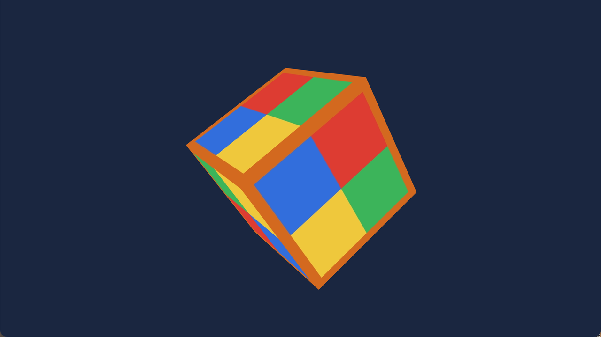
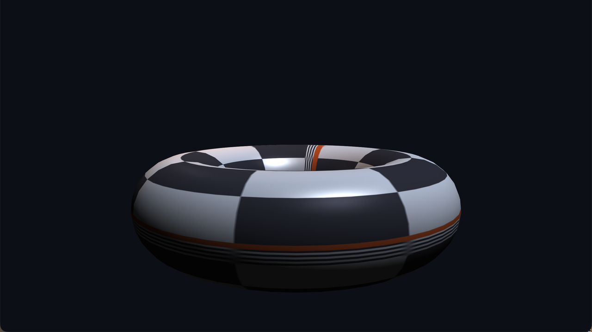
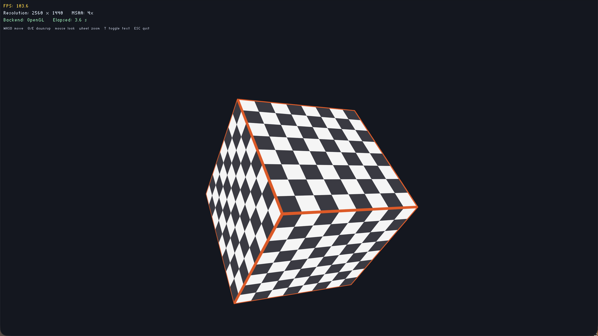

# Class-OpenGL：现代 OpenGL C++ 封装引擎

[](LICENSE)

一个 C++17 / OpenGL 3.3 Core Profile 的渲染引擎封装骨架。
所有 GL 资源（program / buffer / VAO / texture）均由 RAII 类管理，拷贝被禁用、移动被保留；
所有 GL 调用经 `GLCall` 包裹，Debug 下出错立即打印 `文件:行号 调用语句 错误码` 并中断。

## 示例截图

> 以下截图在 macOS / Apple M4 上以 4x MSAA 运行捕获。

**03_cube — 纹理立方体、深度测试与自由相机**



**05_lighting — OBJ 模型、材质、方向光 + 点光源与 Blinn-Phong 光照**



**06_text — 实时文字叠加层：FPS、分辨率、MSAA 与当前渲染后端**



## 功能概览

| 模块 | 文件 | 说明 |
|---|---|---|
| 窗口 | `engine/Window/Window.*` | GLFW 窗口/上下文、回调、VSync、MSAA |
| 错误检查 | `engine/Core/GLCall.h` | Debug 下包裹全部 GL 调用 |
| 着色器 | `engine/Renderer/Shader.*` | 文件/源码构造、编译链接报错、uniform 缓存 |
| 缓冲/VAO | `Buffer.*`、`VertexArray.*` | VBO/EBO/VAO 的 RAII 封装 |
| 纹理 | `Texture.*` | stb_image、自动 RGB/RGBA、mipmap、Y 翻转 |
| 相机 | `Camera.*` | yaw/pitch、WASD、Q/E 升降、滚轮缩放 |
| 渲染命令 | `Renderer.*`、`RenderCommand.*` | 运行时多后端分发、绘制统计 |
| 后端 | `RendererAPI.h`、`OpenGLRendererAPI.*`、`NullRendererAPI.*` | OpenGL 实际后端 + Null 无头后端 |
| 光照/材质 | `Lighting.h` | Blinn-Phong、Material、方向光、点光 |
| 网格/模型 | `Mesh.*`、`Model.*` | 索引网格、Wavefront OBJ 导入 |
| 文字 | `TextRenderer.*` | stb_easy_font 屏幕空间 ASCII 叠加层 |
| Shader 库 | `ShaderLibrary.*` | 单文件 `#type vertex` / `#type fragment` 管理 |

## 项目结构

```text
Class-OpenGL/
├── CMakeLists.txt
├── ARCHITECTURE.md
├── engine/
│   ├── Core/              # Log / GLCall
│   ├── Window/            # GLFW 窗口与输入封装
│   ├── Renderer/          # Shader / Buffer / VAO / Texture / Camera 等
│   └── examples/          # 01_triangle ... 07_backend_switch
├── assets/
│   ├── shaders/           # GLSL 与 .glsl 单文件 shader
│   ├── models/            # torus.obj
│   └── *.png / *.jpg      # 测试纹理
├── third_party/
│   ├── glad/              # 预生成的 OpenGL 3.3 Core loader
│   └── stb/               # stb_image / stb_easy_font
└── docs/images/           # README 截图
```

## 构建

依赖：CMake ≥ 3.16、C++17 编译器。GLFW 与 glm 通过 FetchContent 获取；
glad 与 stb 已放在 `third_party/`，无需联网生成。

```bash
git clone https://github.com/UnmetDecade/Class-OpenGL.git
cd Class-OpenGL
cmake -S . -B build -DCMAKE_BUILD_TYPE=Debug
cmake --build build -j
```

Release 构建（关闭 GLCall 检查）：

```bash
cmake -S . -B build-release -DCMAKE_BUILD_TYPE=Release
cmake --build build-release -j
```

资源目录通过编译定义 `ASSET_DIR` 指向项目的 `assets/`，无需复制可执行文件。

## 示例

| 可执行文件 | 内容 | 操作 |
|---|---|---|
| `01_triangle` | 硬编码 GLSL 三角形，颜色随时间插值 | ESC 退出 |
| `02_texture` | EBO 矩形 + container 贴图 | ESC 退出 |
| `03_cube` | 旋转纹理立方体、深度测试 | WASD、Q/E、鼠标、滚轮、ESC |
| `04_shader_library` | ShaderLibrary + RenderCommand | ESC 退出 |
| `05_lighting` | OBJ torus、棋盘贴图、Material、方向光 + 点光、MSAA | WASD、Q/E、鼠标、滚轮、ESC |
| `06_text` | 3D 场景 + 实时文字叠加层（FPS/分辨率/MSAA/后端） | WASD、Q/E、鼠标、滚轮、T 隐藏文字、ESC |
| `07_backend_switch` | 运行时 OpenGL ↔ Null 后端切换与绘制统计 | B 切换后端、P 打印统计、ESC 退出 |

运行：

```bash
./build/01_triangle
./build/02_texture
./build/03_cube
./build/04_shader_library
./build/05_lighting
./build/06_text
./build/07_backend_switch
```

## 新增能力说明

### MSAA

`Window` 构造函数新增 `int msaaSamples = 4` 参数，`<= 0` 关闭。创建窗口时设置
`GLFW_SAMPLES`，上下文就绪后启用 `GL_MULTISAMPLE`，并通过 `GL_SAMPLES` 查询实际采样数，
`GetMSAASamples()` 返回该值（驱动可能降级）。

### 相机缩放与升降

`CameraMovement` 新增 `Up` / `Down`；`ProcessMouseScroll(float)` 把 FOV 限制在 `[1°, 45°]`，
`GetZoom()` 读取当前 FOV。`Window` 新增 `SetScrollCallback`。

### 光照与材质

`Lighting.h` 提供三个值类型：

- `Material`：ambient / diffuse / specular / shininess，`Apply(Shader&)`
- `DirectionalLight`：方向、三种颜色，`Apply(Shader&)`
- `PointLight`：位置、距离衰减系数、三种颜色，`Apply(Shader&)`

`assets/shaders/lighting.vert/.frag` 使用 Blinn-Phong，支持法线矩阵、方向光、点光与漫反射贴图。

### 模型导入

`Model` 解析 Wavefront OBJ 的 `v` / `vt` / `vn` / `f`：

- 多边形按扇形三角化
- 支持负索引
- 缺省法线时按面积加权计算平滑法线
- 每个 `Model` 持有一个或多个 `Mesh`

明确不解析 `.mtl`、纹理引用、材质组与骨骼动画。

### 文字

`TextRenderer::Draw(text, x, y, scale, color, viewportWidth, viewportHeight)`：

- 使用 `stb_easy_font`，ASCII 点阵四边形，无需外部字体文件
- y 轴向下的屏幕空间正交投影，坐标为像素
- 绘制时临时关闭深度测试，结束后恢复
- 顶点为 `(vec3 pos, vec4 color)`，动态上传

### 运行时多后端

`Renderer` 内部持有 `std::unique_ptr<RendererAPI>`，`SetBackend(RendererBackend::OpenGL / Null)`
可在运行中切换；`GetStats()` 返回当前后端的 clear/draw/index/vertex 计数，
切换时旧后端统计会写入日志。

- **OpenGL 后端**：真实执行 GL 命令，所有调用仍经 `GLCall`
- **Null 后端**：不发出任何 GL 命令，只校验资源句柄并累计统计，用于无头/基准路径验证

这是**命令级**后端抽象：VAO/VBO/Texture 等资源类仍由 OpenGL 具体类型持有；
若要支持 Vulkan/Metal，需要再抽象一层 GPU 资源接口。示例 `07_backend_switch` 演示运行时切换。

## 自检清单

- [x] 所有 GL 对象析构释放：Shader、VBO、EBO、VAO、Texture、TextRenderer 均实现析构
- [x] 拷贝构造/赋值已 `= delete`，移动构造/赋值保留（Window/Shader/Buffer/VAO/Texture/Mesh/Model/TextRenderer）
- [x] 着色器编译/链接失败抛出 `std::runtime_error`，包含 VERTEX/FRAGMENT/LINK 与完整 info log
- [x] 本阶段全部 GL 调用经 `GLCall`（`OpenGLRendererAPI`、`TextRenderer`、`Window`、资源类）
- [x] 多后端切换会记录旧后端统计并重新初始化新后端
- [x] 示例 01–07 在 macOS 与 Ubuntu 22.04 均编译、启动、运行通过

## 验证记录

- macOS（Apple M4）：OpenGL 4.1 Metal，MSAA 4x，示例 01–07 均运行正常；
  05 的 torus 光照/贴图与 06 的文字叠加层经截图确认；07 用模拟按键验证
  `OpenGL → Null → OpenGL` 切换与统计输出。
- Ubuntu 22.04（Xwayland + Mesa llvmpipe）：OpenGL 4.5 Core，MSAA 4x，
  示例 01–07 均启动运行，无 `GL_INVALID_*` 中断。

## 明确未实现

- OBJ 的 `.mtl` 材质、外部贴图与多材质分组
- 阴影、法线贴图、PBR、后处理、HDR、骨骼动画
- 非 ASCII 文字、字体图集、文本换行与布局
- Null 后端不是 GPU 无关的资源抽象，仍依赖已创建的 OpenGL 句柄
- 文字叠加层直接使用 OpenGL 绘制（调试 UI），不经过 `RendererAPI`
- 音频、物理、场景图、资源热重载、编辑器
- 未引入 boost / Qt / assimp 等约定外第三方库

## 第三方组件

项目使用 GLFW、glm、glad、stb 等第三方库；各库许可证见其源码目录或文件头。

## License

本项目采用 [MIT License](LICENSE) 发布。

